# UGI – Universal Game Importer

A Millennium plugin that brings any game into your Steam library and gets its pictures, store information and achievements where available.
It works with every game from the supported launchers (imported automatically) and with every other non-Steam game, even the ones you add by hand.

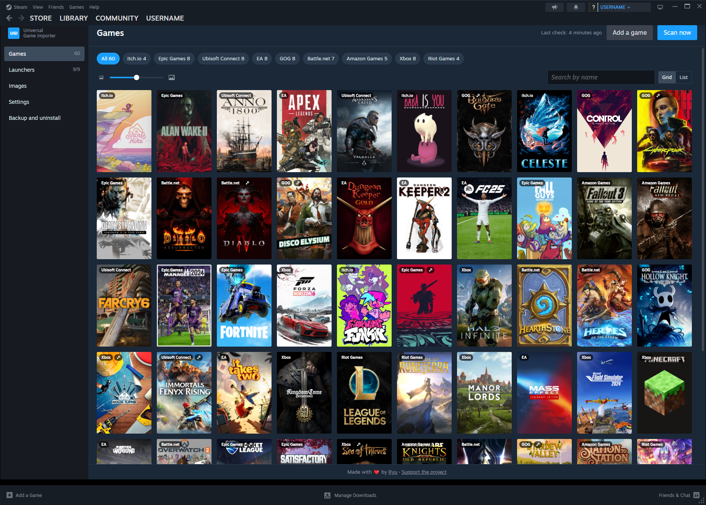

## Features

### Every game, in one library

Steam is where your friends, your controller settings and your Big Picture couch setup already live, so why should a game be left out just because you bought it somewhere else? UGI looks through Xbox / Microsoft Store, Epic Games, GOG Galaxy, EA app, Battle.net, Amazon Games, Ubisoft Connect, itch.io and Riot Games, and brings every installed game into Steam for you.

Got something that doesn't come from any launcher, like an old CD game, an indie download or a mod? Click **Add a game**, pick its program, check the name UGI suggests, and it joins the others in an "Imported games" collection, with the same pictures and game page.

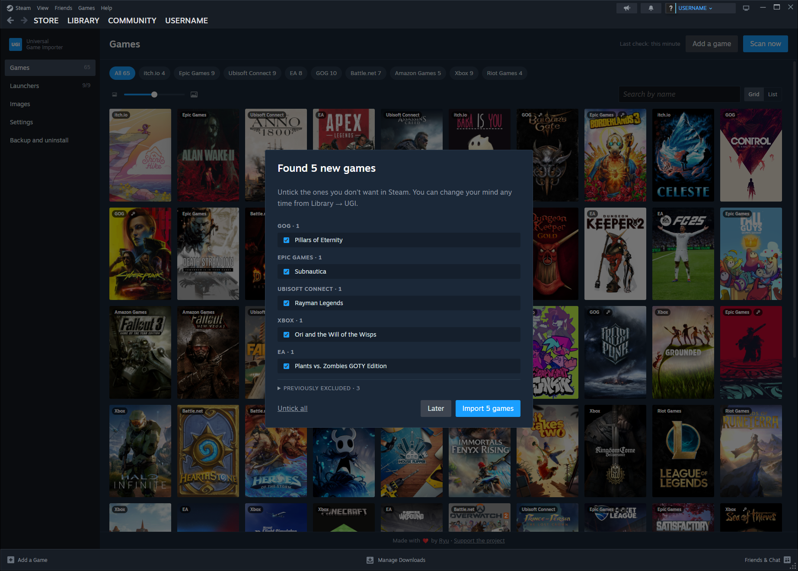

### Press Play and forget about it

Games start through their own launcher, exactly as they would from there, while Steam shows you "In game" and counts your playtime. Steam's overlay works out of the box; if a game doesn't get along with it, turn it off for that game alone, and Steam will consider it closed the moment you quit, even if its launcher stays open.

### A library that looks after itself

Install a new game and UGI tells you with a notification, ready to add it in one click. Uninstall one and it disappears from Steam; move or update one and its shortcut follows. Already added some games to Steam by hand? UGI takes them over, playtime included, so each game shows up only once, in its launcher's collection. Every launcher can get its own collection and its own shelf on the Home page.

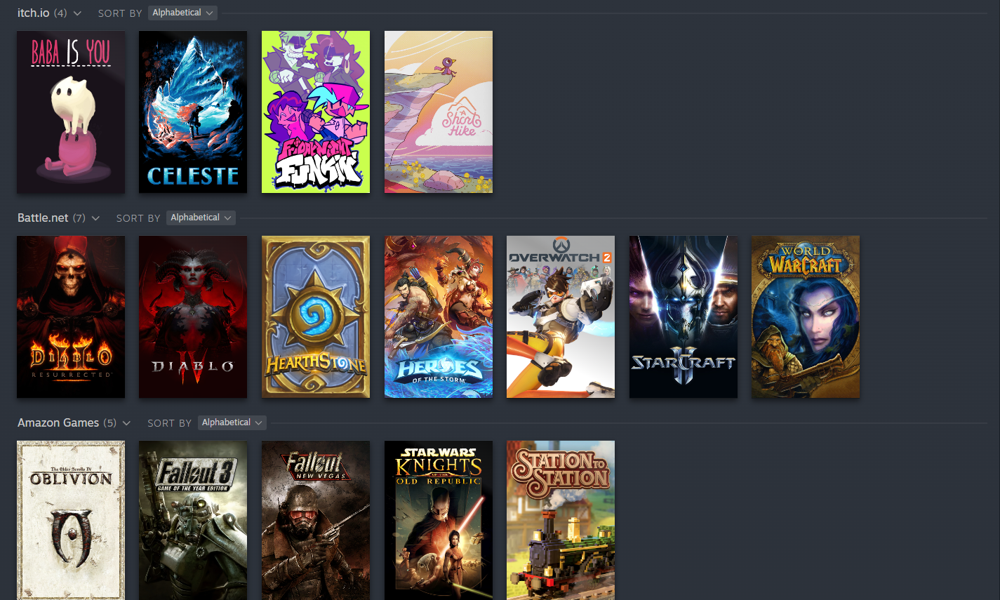

### Beautiful, not just present

No more grey boxes: UGI picks a cover, a wide cover, a background, a logo and an icon from SteamGridDB for every new game. Prefer another one? "Custom images (UGI)" in the game's menu opens a gallery, animated pictures included. And it works for your whole library too, Steam games as well: fill only what's missing, replace everything, or go back to the originals, with a progress bar and a Stop button.

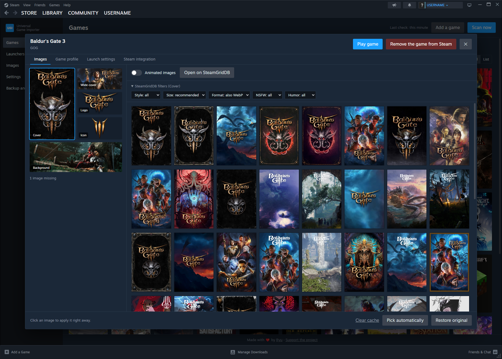

### A real store page for every game

Open a non-Steam game in your library and you'll find what a store page would show you: trailers and screenshots, summary and description, reviews, release date, developer and publisher, system requirements, languages, age rating and Metacritic score, with links to the game's own store. Everything is fetched when the game is imported and kept ready, so the page opens instantly.

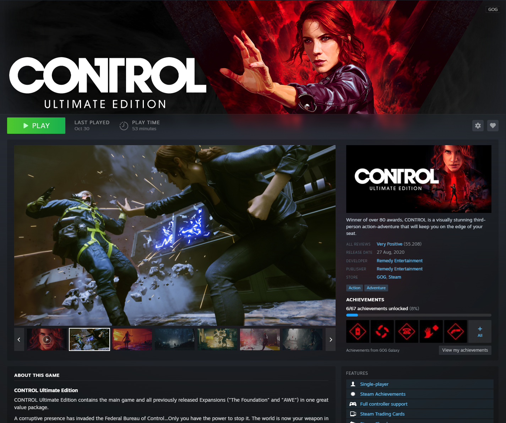

### Your achievements, where you play

GOG, Xbox and Epic Games achievements appear right on the game's page: your progress, the latest unlocked, and the full list with dates and rarity, with secret ones kept hidden until you choose to look. And while you play, every achievement you unlock pops up as a Steam notification.

### Made for the couch too

In Big Picture mode, game information and achievements sit in the "Game info" tab, and everything works with a controller: the right stick scrolls like a mouse wheel, A and B move into and out of each part. UGI's own page, the gallery and every dialog are controller-friendly as well.

### Everything else

Each game has its own window in UGI's page, with tabs for its pictures, its launch settings and Steam's overlay. There you can start a DRM-free game straight from its own program instead of its launcher (its achievements may then not be recorded), add launch arguments, change its program or start folder, and choose how long after its last window closes Steam counts it as closed. Settings, imported games and pictures can be backed up and restored at any time. UGI is translated into every language Steam offers, and follows Steam's language by default.

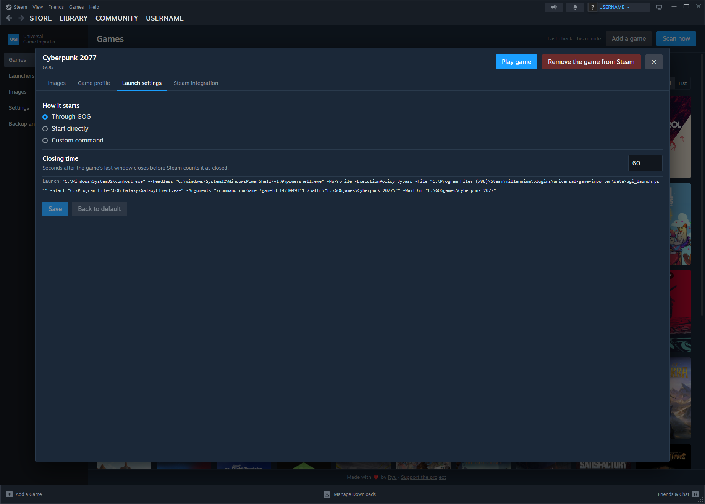

### What works where

✅ works · 🟡 partly (see the notes) · 🌐 through an external service or API (some need a free key or a sign-in, see [Configuration](#configuration)) · ❌ not available

| Feature | Xbox | Epic | GOG | EA | Battle.net | Amazon | Ubisoft | itch.io | Riot | Added by hand |
|---|:-:|:-:|:-:|:-:|:-:|:-:|:-:|:-:|:-:|:-:|
| Found and imported automatically | ✅ | ✅ | ✅ | ✅ | 🟡¹ | ✅ | ✅ | ✅ | ✅ | ❌² |
| Starts from Steam, "In game" and playtime | ✅ | ✅ | ✅³ | ✅ | ✅ | ✅ | ✅ | ✅ | ✅ | ✅ |
| Steam overlay, can be turned off per game | 🟡⁴ | ✅ | ✅ | ✅ | ✅ | ✅ | ✅ | ✅ | ✅ | 🟡⁴ |
| New games announced, removed when uninstalled | ✅ | ✅ | ✅ | ✅ | ✅ | ✅ | ✅ | ✅ | ✅ | 🟡⁵ |
| Takes over games already added to Steam by hand | ✅ | ✅ | ✅ | ✅ | ✅ | ✅ | ✅ | ✅ | ✅ | ❌ |
| Collection and Home shelf | ✅ | ✅ | ✅ | ✅ | ✅ | ✅ | ✅ | ✅ | ✅ | ✅ |
| Pictures from SteamGridDB | 🌐 | 🌐 | 🌐 | 🌐 | 🌐 | 🌐 | 🌐 | 🌐 | 🌐 | 🌐 |
| Game information page | 🌐 | 🌐 | 🌐 | 🌐⁶ | 🌐⁶ | 🌐⁶ | 🌐⁶ | 🌐⁶ | 🌐⁶ | 🌐⁶ |
| Link to the game's own store | 🌐 | 🌐 | 🌐 | ❌ | 🟡⁷ | ❌ | ❌ | ❌ | ❌ | ❌ |
| Achievements on the game's page | 🌐⁸ | 🌐⁹ | ✅¹⁰ | ❌ | ❌ | ❌ | ❌ | ❌ | ❌ | ❌ |
| Achievement notifications while playing | 🌐⁸ | 🌐⁹ | ✅¹⁰ | ❌ | ❌ | ❌ | ❌ | ❌ | ❌ | ❌ |
| Big Picture and controller | ✅ | ✅ | ✅ | ✅ | ✅ | ✅ | ✅ | ✅ | ✅ | ✅ |
| Backup and restore | ✅ | ✅ | ✅ | ✅ | ✅ | ✅ | ✅ | ✅ | ✅ | ✅ |

1. Blizzard's own games and the Call of Duty, Crash Bandicoot and Destiny 2 releases on Battle.net; other games on Battle.net aren't recognized yet.
2. Added with **Add a game** in UGI's page.
3. Through GOG Galaxy when it's installed, otherwise straight from the game's program (GOG games are DRM-free).
4. The overlay always works, but can't be turned off for these games.
5. Removed when its program or its Steam shortcut is gone.
6. From Steam's store when the game is also sold there, otherwise from RAWG (needs a free key). Xbox, Epic and GOG games also use their own store.
7. Only for the Blizzard games known to UGI.
8. With an OpenXBL key every Xbox game; without it, only the games you opened in the Xbox app (read from its cache). Xbox notifications arrive within five minutes.
9. The list comes from the Epic Games Store; which ones you unlocked needs your Epic account. Notifications arrive within two minutes.
10. Read from GOG Galaxy's own database on your PC: Galaxy must be installed and signed in. Notifications are immediate.

## Configuration

UGI's page is in Steam's **LIBRARY** menu (**UGI**). The first time, a short setup guides you through it.

In UGI's **Settings**:

* How often UGI looks for new games: off (only "Scan now"), daily, weekly or monthly
* Collections and Home shelves, animated pictures, WebP pictures
* Language (follows Steam's by default) and theme (Steam or Modern)

Optional keys and accounts, also in UGI's **Settings**:

* SteamGridDB API key: needed for the pictures. Free key: https://www.steamgriddb.com/profile/preferences/api
* RAWG API key: information for games not found on Steam, GOG or Epic (texts in English). Free key: https://rawg.io/apidocs
* OpenXBL API key: achievements of every Xbox game; without it, only those of the games you opened in the Xbox app. Free key: https://xbl.io
* Epic account: to see which Epic achievements you unlocked

More screenshots

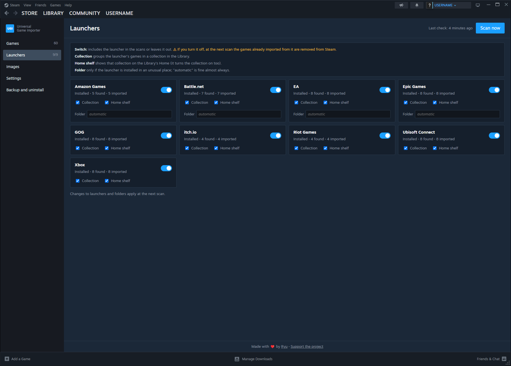

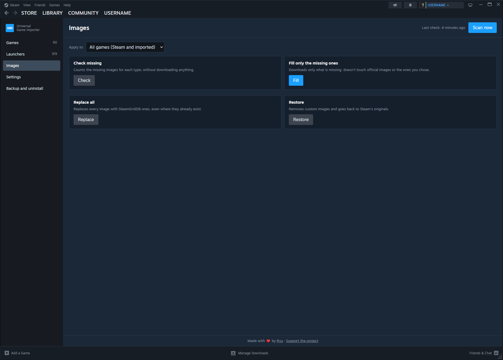

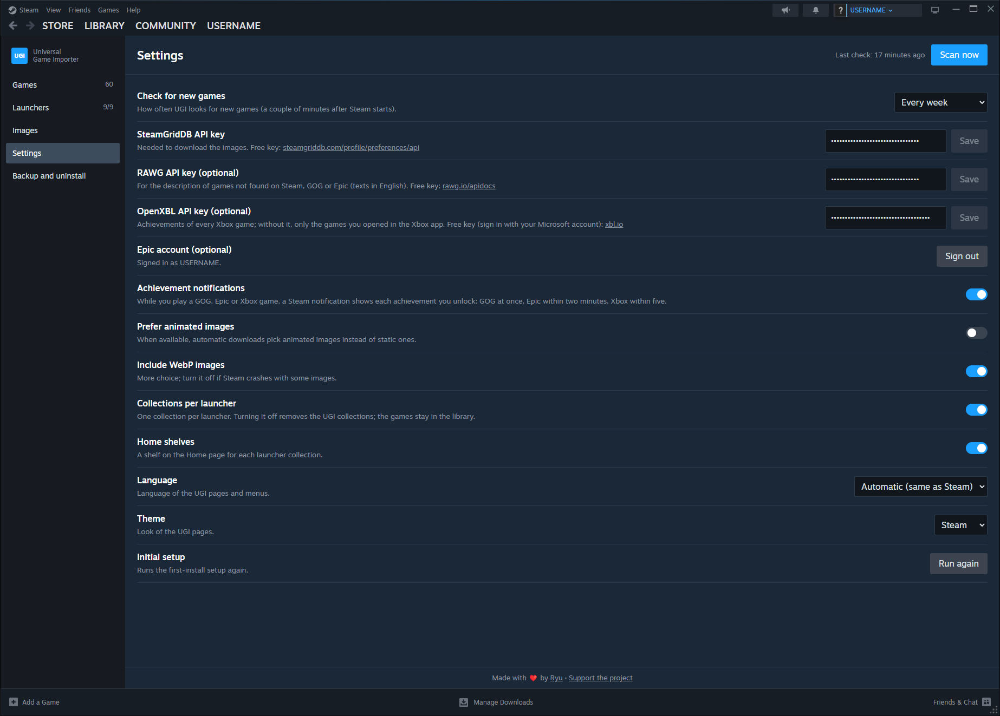

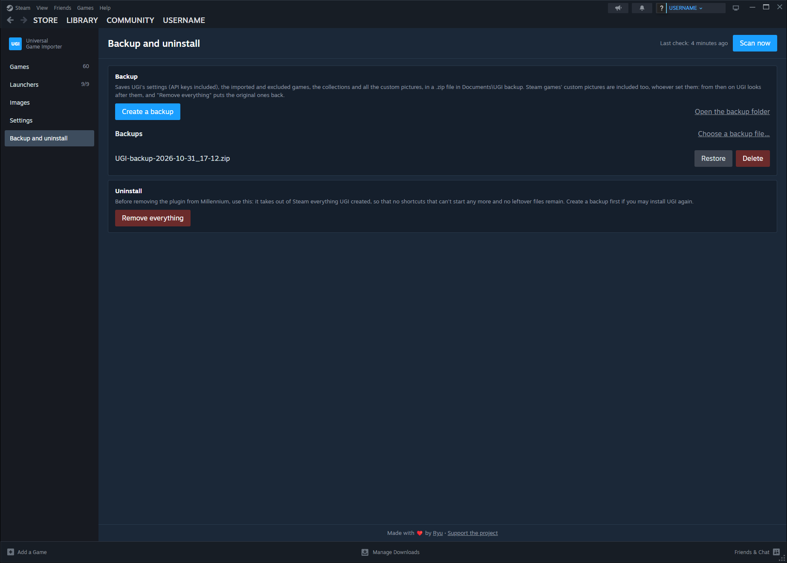

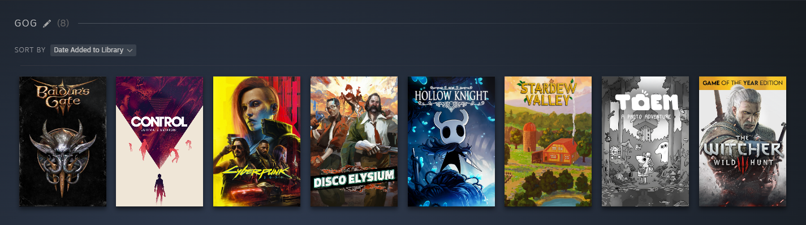

## Prerequisites

* Windows
* [Millennium](https://steambrew.app/)

## Installation

* Copy the plugin ID from the [Millennium plugins](https://steambrew.app/plugins) page
* Click `Plugins` and `Install a plugin` in the Millennium settings and paste the ID
* Restart Steam

## Installation - manual

* Download the latest release from GitHub Releases
* Extract it into Millennium's plugins folder (usually `C:\Program Files (x86)\Steam\millennium\plugins`)
* Enable the plugin in the Millennium settings and restart Steam

## Known issues

* After installing or updating the plugin, Steam has to be restarted

## Coming soon

* Linux and Steam Deck/Steam Machine compatibility
* Rockstar Games Launcher

## Support

UGI is free and always will be. If it made your library a little nicer, you can buy me a coffee:

A ⭐ on GitHub helps too: it makes UGI easier for others to find.

## Special thanks

UGI wouldn't be what it is without:

- **Yuki "manu suka" Quello vero**, for the embarrassing amount of bugs they helped track down and for all the ideas they suggested.
- **ManuKM Dehpefforzah**, for the ideas and testing behind the Linux and Steam Deck version (still a work in progress!).
- **The GWIBBA community**, for all the love and support for the project.

## License

GNU General Public License v3.0 — see [LICENSE](LICENSE).
Third-party code and its licenses are listed in [THIRD_PARTY_NOTICES.md](THIRD_PARTY_NOTICES.md).
